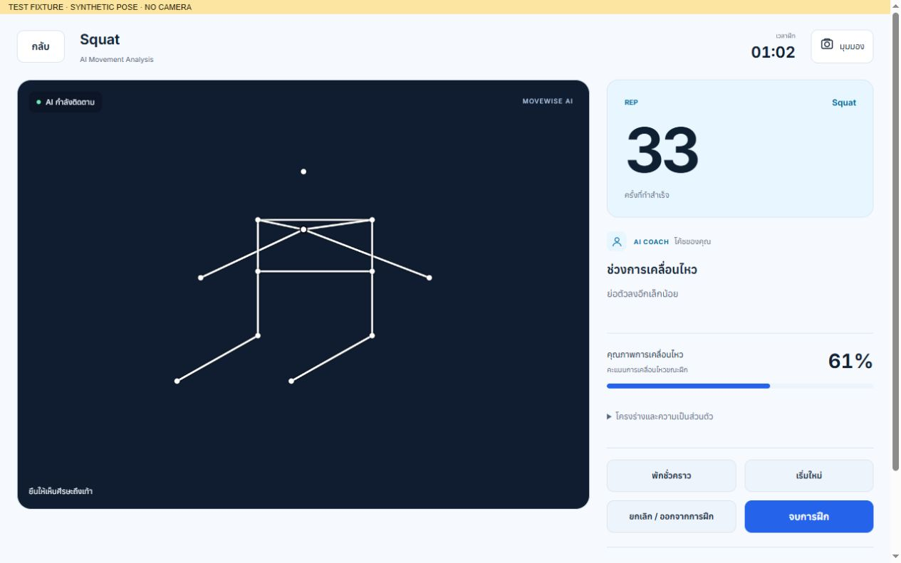
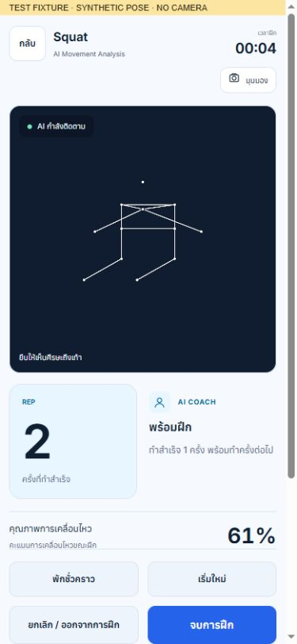
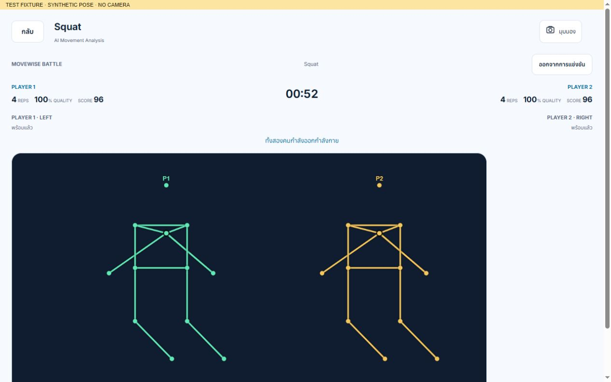

# MoveWise AI 3.0 — implementation and verification

Date: 10 November 2026. Base: `feat/premium-product-upgrade` at `d151ce6`, selected because the originally named development branch was absent. Implementation branch: `feat/movewise-product-redesign`.

## Implemented behavior

- Restored independent measured results: the results renderer previously required a skeleton visual before showing numeric movement metrics. Opting out of capture or deleting skeletons now preserves measured metrics.
- Corrected completed-rep evidence: retain the actual metric tuple at greatest observed range, rather than the neutral return frame. Jumping Jack arm range now measures shoulder elevation relative to the torso. Unavailable tempo consistency stays null; Six Seven times its first transition from the calibrated starting pose.
- Start/Ready arms tracking; approximately two stable seconds precede an automatic five-second countdown. Invalid landmarks or stale/frozen frames cancel preparation. Online readiness uses expiring server leases, authoritative countdown/start timestamps, revisioned snapshots, and serialized metric uploads. Old responses cannot update a different room.
- Solo pause/resume excludes paused time; restart re-arms preparation. Duration and/or rep targets finish Solo automatically. Local and online battles support configurable duration. Zero-rep completed sessions save null measurements when no attempt was measured; failed saves expose retry.
- Camera-first desktop and mobile layouts, expandable live metrics, compact battle scores outside the camera, and accessible cancellation. Local assignment rejects duplicate/ambiguous poses; identity ambiguity stops counting and asks for a new match rather than guessing identities.
- Reusable classic-worker MediaPipe path on compatible browsers, one transferred frame in flight, adaptive pacing, duplicate-video-frame suppression, CPU/main-thread compatibility fallback, bounded timing history and streaming per-frame averages. Numeric displays avoid unchanged writes; coaching is paced to one short instruction.
- Optional skeleton-only evidence is off by default, bounded to three completed reps, and deletable from Results or Profile. Raw camera video is neither recorded nor uploaded. Gemini receives measured summaries, never images/landmark trails. Recurring supported issues retain exercise/session associations; coaching trends require comparable exercise and measurement version.
- Existing analyzers, storage key and top-level session format are retained. New rep records carry optional `measurementVersion: 2` metadata; historical sessions are readable without migration.

## Automated verification

- Node 24.20.0: **106/106 passed, 0 failed** using `node --test tests/*.test.js` (equivalent to `npm test`).
- Browser fixture runner: **10/10 passed**. It exercises the actual app at 390px with disposable in-memory test storage: startup, countdown cancellation, frozen/missing tracking, camera denial, pause/resume, restart, automatic completion/saving, zero-rep nulls, skeleton deletion, mobile overflow/touch targets, late async cancellation, and two independent Local Battle analyzers.
- Two browser clients were also exercised against the same online room: synchronized start/remaining time and opposing results at automatic completion. Server tests cover readiness expiration, cancellation/re-readiness, disconnect/reconnect, authentication, synchronized start/finish and forfeits.
- Worker regression tests cover transfer ownership, one-frame backpressure, initialization failure, crash rejection and cleanup. Real MediaPipe CPU inference ran in the worker on generated non-person video.
- Production serving rejects `/qa`, `/_qa/...`, and test files. `git diff --check` passed.

The HTTP battle test previously used a 120ms match window and failed under simultaneous model profiling. Its window is now one second, retaining all assertions; exact timing boundaries have separate fake-timer coverage. A zero-rep browser fixture was changed to a stationary pose so it tests “no attempts” rather than a real incomplete attempt.

## Measured performance

Real pinned MediaPipe model, CPU delegate, same browser, generated non-person 640×480 video, fixed 1280×800 viewport, sequential warmed ~10-second windows, 20 FPS cap:

| Measurement | Baseline main thread | CPU worker |
| --- | ---: | ---: |
| Observed detection FPS | 16.29 | 11.56 |
| Mean model inference (ms) | 37.90 | 65.68 |
| Frame processing → UI (ms) | 38.18 | 68.00 |
| Mean 100ms timer lateness (ms) | 10.85 | 1.45 |
| Maximum timer lateness (ms) | 78.10 | 22.40 |
| Observed startup to first result (ms) | 1087.60 | 1639.30 |
| Main JS heap snapshot (MiB) | 14.99 | 10.29 |

**Tradeoff:** the CPU worker improved control-thread responsiveness in this sample while reducing inference FPS and increasing processing latency. This is not a claim of an overall inference speedup. The preview video remains independent of inference pacing. Startup cache state was not controlled, and main JS heap excludes worker/WASM/GPU memory, so these values do not establish startup or total-memory improvements. OS CPU utilization and total application memory were unavailable.

An earlier synthetic-squat UI sample (no MediaPipe) reduced control-panel mutations from **634 to 112** over ~10 active seconds. Mean processing was 0.57→0.28ms and sampled rep-feedback latency 1.0→0.7ms; these describe the synthetic UI path only. Synthetic caps of 15/20/30 produced approximately 13.69/16.98/28.32 inference FPS in individual samples. The default remains 20 with device pacing; these figures do not predict physical-device accuracy or real-model throughput.

The first real-model CPU probe exposed several seconds of startup blocking. Google documents that MediaPipe detection calls are synchronous and can block the UI thread: [official Pose Landmarker Web guide](https://developers.google.com/edge/mediapipe/solutions/vision/pose_landmarker/web_js). A classic worker was necessary for this SDK's WASM `importScripts` loader. An explicit GPU probe became unresponsive; it has no usable benchmark result and GPU is not the default.

## Reproduce

`npm start` serves the real application at http://127.0.0.1:4173. `npm run test:browser` serves isolated fixtures at http://127.0.0.1:4174; open `/qa` to run browser regressions. `?model=real` uses real MediaPipe on generated video, and “Sample next 10 seconds” resets a warmed measurement window. `?poseFps=15`, `20`, or `30` selects an inference cap. Fixtures are never production routes.

## Remaining limitations

- No physical-camera exercise-accuracy study, real two-person camera trial, or physical-phone validation was performed. Synthetic tests and generated video cannot establish real-world counting/biomechanical accuracy.
- CPU-worker transport/inference throughput needs additional device profiling; the measured responsiveness/FPS tradeoff is explicit above. GPU compatibility remains unverified after the failed probe. Unsupported worker paths retain main-thread inference.
- Local identity is positional, not biometric re-identification. Athletes must keep their assigned sides; ambiguous tracking stops crediting repetitions and requires a new match.
- Online rooms remain process-local/in-memory and require a persistent Node/SSE server; restarts lose rooms and multiple instances need shared room state. Internet latency still affects score delivery.
- Gemini live-service output was not exercised without a key; API behavior, payload restrictions, failures and fallback were tested with mocks. Scores are heuristics and “accuracy” is completion rate, not clinical or ground-truth recognition accuracy.
- Historical numeric scores remain as stored. New coaching comparisons avoid mixing measurement versions; historical aggregate averages should not be interpreted as validated cross-version improvements.

No merge or deployment was performed.

## Review evidence

The final online clients reported “คุณชนะ!” / “ครั้งหน้าลองใหม่”, with summaries “17 ครั้ง · ครบเวลา” / “16 ครั้ง · ครบเวลา”. These are synthetic fixtures, not physical-camera findings.

